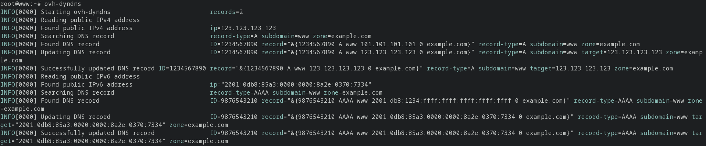

<p align="center">
    
</p>

<div align="center">

  [](https://pkg.go.dev/github.com/TheoBrigitte/ovh-dyndns)
  [](https://github.com/TheoBrigitte/ovh-dyndns/actions/workflows/ci.yaml)
  [](https://github.com/TheoBrigitte/ovh-dyndns/releases/latest)
  [](https://scorecard.dev/viewer/?uri=github.com/TheoBrigitte/ovh-dyndns)

</div>

A DynDns-like client for domain names hosted at OVH.
It retrieves the public IP address or hostname and updates the DNS record accordingly.

- The public IP address is resolved by [go-external-ip][1], which queries several
  providers and keeps the most voted value.
- Hostname is discovered by issuing a reverse DNS lookup request.
- OVH API communication is handled by [go-ovh][2] client.

It runs once and exits, so it is meant to be triggered periodically, for example
by the provided systemd timer.



## Public IP providers

All providers below are queried in parallel, with a 30 seconds timeout. Each
answer counts as a vote weighted by the provider, unreachable providers are
ignored, and the address gathering the most votes wins.

| Provider                             | Weight |
|--------------------------------------|--------|
| `https://icanhazip.com/`             | 3      |
| `https://myexternalip.com/raw`       | 3      |
| `http://ifconfig.io/ip`              | 1      |
| `http://checkip.amazonaws.com/`      | 1      |
| `http://ident.me/`                   | 1      |
| `http://whatismyip.akamai.com/`      | 1      |
| `http://myip.dnsomatic.com/`         | 1      |
| `http://diagnostic.opendns.com/myip` | 1      |

TLS-protected providers carry a heavier weight than plain-text ones. This is the
default provider set from [go-external-ip][1], it is not configurable.

## Supported record types

| Record type | Target                                              |
|-------------|-----------------------------------------------------|
| `A`         | public IPv4 address                                 |
| `AAAA`      | public IPv6 address                                 |
| `CNAME`     | reverse DNS lookup of the public IPv4 address       |

Records are created when missing, updated when the target changed, and left
untouched otherwise. The DNS zone is refreshed after each create or update.
Any number of zones, record types and subdomains can be configured, each target
is resolved at most once per run.

## Install

#### Binary

Download the binary for your platform from the [latest release][4], or build it
from source:

```
go install github.com/TheoBrigitte/ovh-dyndns@latest
sudo install "$(go env GOPATH)/bin/ovh-dyndns" /usr/local/bin/
```

#### Configuration

Two configuration files are needed. Beware that they are looked up in opposite
orders.

`ovh-dyndns.toml` holds the DNS record(s) to be updated. The first file found is
used, the others are ignored:

1. `/etc/ovh-dyndns/ovh-dyndns.toml`
2. `$HOME/ovh-dyndns.toml`
3. `./ovh-dyndns.toml`

`ovh.conf` holds OVH API credentials. You can get those from [ovh.com][3]. All
files found are merged, the last one wins on a per-key basis:

1. `/etc/ovh.conf`
2. `$HOME/.ovh.conf`
3. `./ovh.conf`

Each credential can also be set through the `OVH_ENDPOINT`,
`OVH_APPLICATION_KEY`, `OVH_APPLICATION_SECRET` and `OVH_CONSUMER_KEY`
environment variables, which take precedence over all files.

Create the user the service runs as, and install both files:

```
sudo useradd --system --no-create-home --shell /usr/sbin/nologin ovh-dyndns
sudo mkdir -p /etc/ovh-dyndns
sudo cp config/ovh-dyndns.toml.sample /etc/ovh-dyndns/ovh-dyndns.toml
sudo cp config/ovh.conf.sample /etc/ovh.conf
```

Then fill in the application key and secret in `/etc/ovh.conf` and generate a
consumer key:

```
ovh-dyndns --consumer-key
```

Visit the validation URL printed in the output to activate the key, then store it
as `consumer_key` in `/etc/ovh.conf`. The key is requested with read access on
`/me` and read-write access on `/domain`.

`/etc/ovh.conf` holds credentials allowing to modify your DNS records, restrict
it to the user running the service:

```
sudo chown root:ovh-dyndns /etc/ovh.conf
sudo chmod 640 /etc/ovh.conf
```

#### Systemd

The service runs as the `ovh-dyndns` user and the timer triggers it every 10
minutes. Runs missed while the machine was off are caught up on the next boot.

```
sudo cp systemd/ovh-dyndns.service systemd/ovh-dyndns.timer /etc/systemd/system/
sudo systemctl daemon-reload
sudo systemctl enable --now ovh-dyndns.timer
```

Only the timer is enabled, the service is triggered by it. Run it once to check
the configuration:

```
sudo systemctl start ovh-dyndns.service
journalctl -u ovh-dyndns.service
```

## Usage

```
ovh-dyndns                 update the DNS records from the configuration file
ovh-dyndns --consumer-key  generate a consumer key
ovh-dyndns --version       print version and exit
```

## Development

`make help` lists all available targets, the most useful ones being:

```
make setup     install the pre-commit hooks
make build     build the binary into build/
make install   build and install the binary into /usr/local/bin
make test      run the test suite
make lint      run all linters
```

[1]: https://github.com/glendc/go-external-ip
[2]: https://github.com/ovh/go-ovh/
[3]: https://docs.ovhcloud.com/en/guides/manage-and-operate/api/first-steps
[4]: https://github.com/TheoBrigitte/ovh-dyndns/releases/latest
